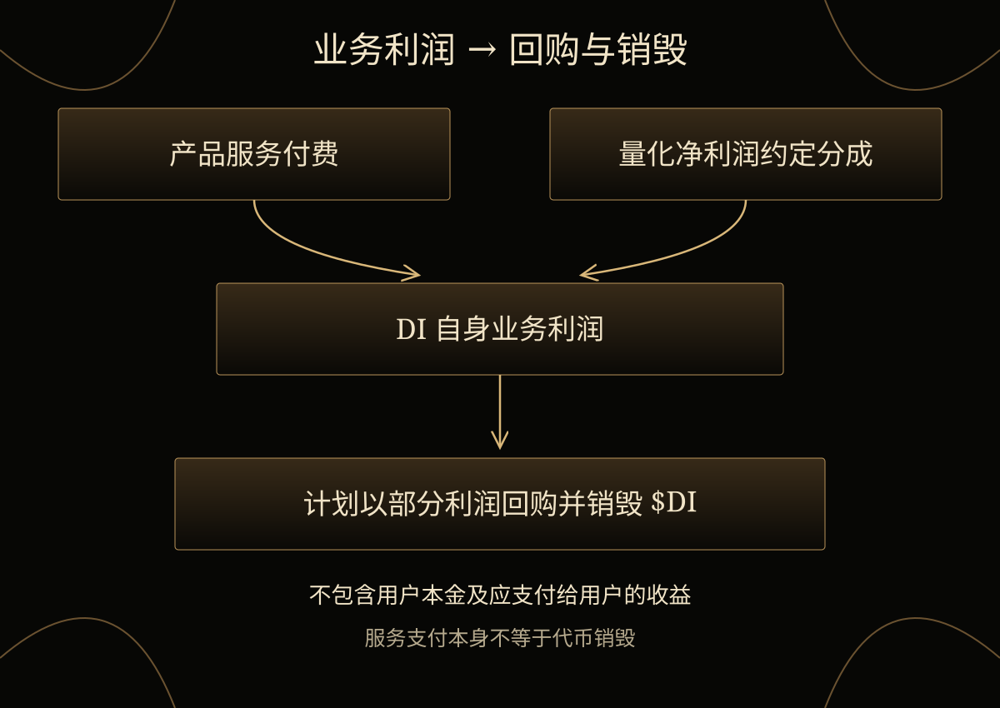

# 13. 商业模式

DI 计划通过产品服务付费及量化产品实际可分配净利润的约定分成获得收入，并计划以自身部分业务利润回购并销毁 $DI。

## 业务收入来源

持有 $DI 可按相应产品规则使用基础数据看板与部分自有策略。付费策略、Event Engine 推演、专业数据 API 与机构服务形成其他服务收入来源。个人 Agent 的任务、工具调用及网络协作，随相应阶段开放后增加服务付费场景。

量化产品可按协议向 DI 分配实际可分配净利润的一部分，计算与分配方式以具体约定为准；参与不保证产生利润。第一阶段由用户自行保管资金。

DI 的研究与产品范围覆盖美股和加密市场，具体可用能力以产品阶段和规则为准。

## 业务利润、回购与销毁

计划用于回购并销毁的资金来自 DI 自身部分业务利润，包括自营量化及专业数据 API 等其他产品的利润；不包含用户本金或应支付给用户的收益。支付服务费用本身不等于销毁 $DI。

可用金额取决于实际经营表现。这项计划不构成固定执行周期、销毁比例、代币价格目标或收益保证。

## 随产品阶段拓展

DI 已完成产品构建，接下来推进上线。付费服务与量化产品构成初期业务基础；个人 Agent 和网络在后续路线图阶段拓展服务模式。
