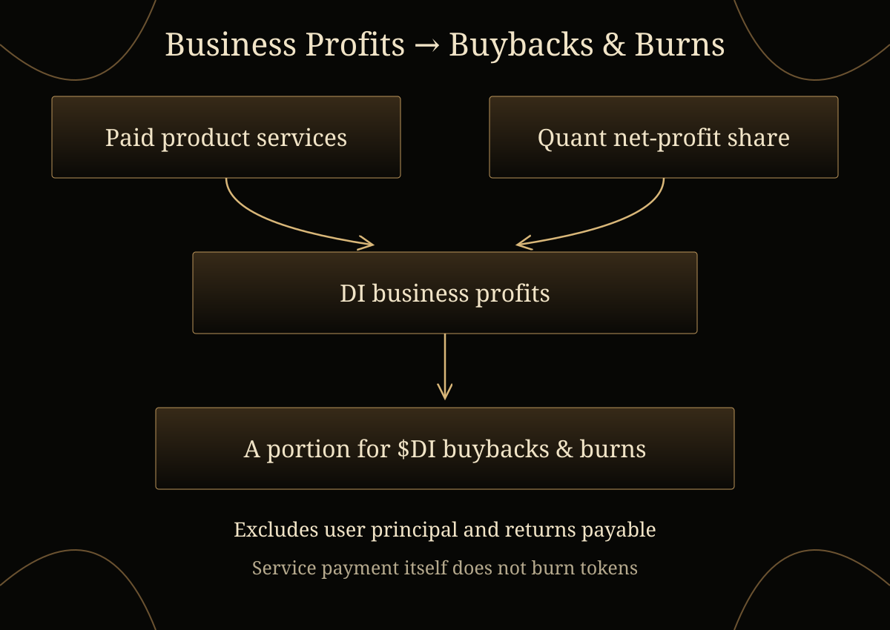

# 14. Business Model

DI plans to earn revenue from paid product services and an agreed share of actually distributable net profit from quant products. A portion of DI’s own business profits is planned to fund $DI buybacks and burns.

## Sources of business revenue

Holding $DI provides access to the basic Data Dashboard and selected in-house strategies under the applicable product rules. Paid strategies, Event Engine simulations, professional data APIs and institutional services create additional service-revenue sources. Personal Agent tasks, tool calls and network collaboration add payment use cases as their respective stages become available.

Quant products may generate revenue for DI through an agreed share of actually distributable net profit. The applicable agreement defines the calculation and distribution; participation does not guarantee a profit. During the first phase, users retain custody of their funds.

DI’s research and product scope covers US equity and crypto markets. Availability depends on the product stage and applicable product rules.

## Business profits, buybacks and burns

Planned buybacks and burns are funded from a portion of DI’s own business profits, including profits from its quant business and other products such as professional data APIs. User principal and returns payable to users are excluded. Payment for a service does not itself burn $DI.

The amount available depends on actual business performance. This plan does not establish a fixed execution schedule, burn ratio, token price target or return guarantee.

## Development across product stages

DI has completed product development and is preparing for launch. Paid services and quant products form the initial business foundation; Personal Agents and the network expand the service model in later roadmap stages.
